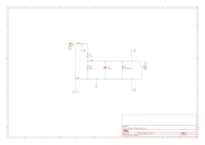
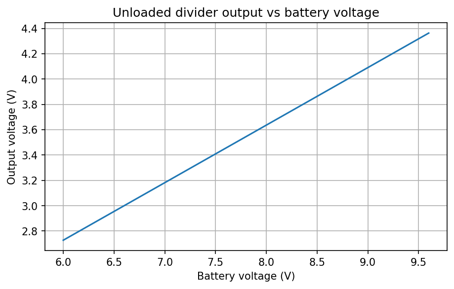
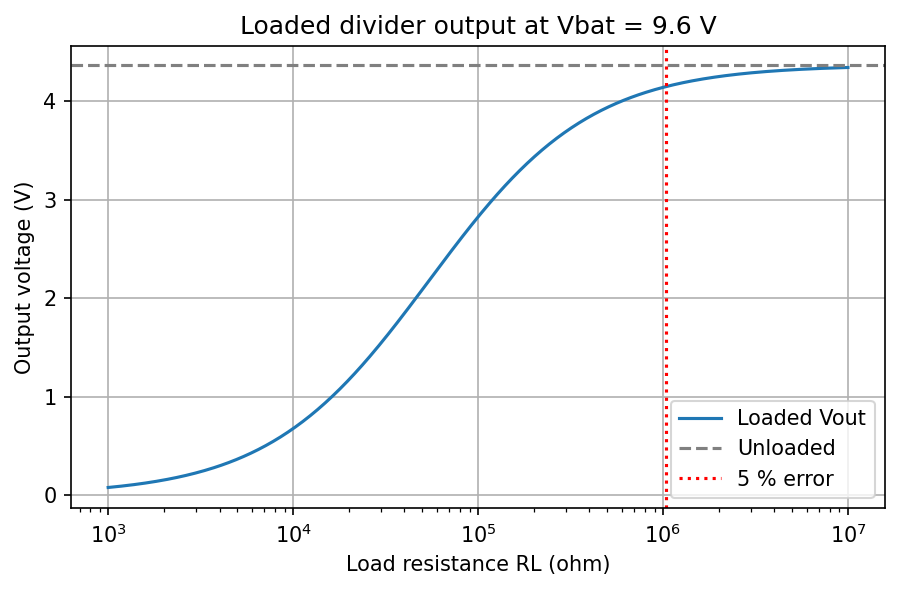
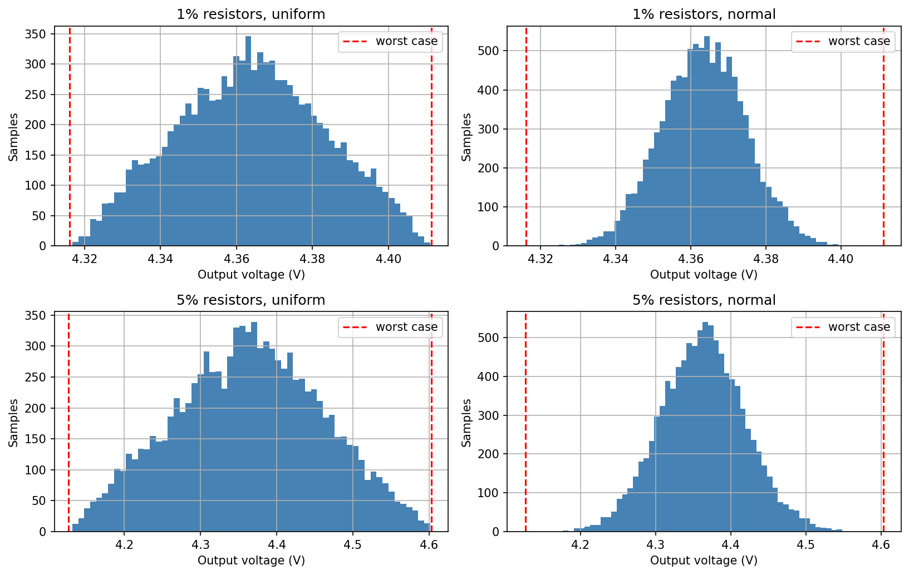
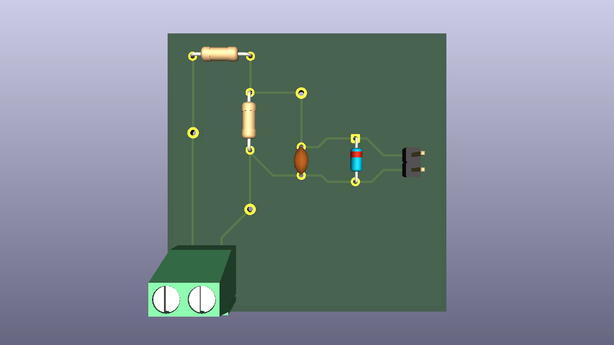

# Voltage divider with RC filter and zener protection

A small measurement board that turns a 9 V battery (6 to 9.6 V) into a filtered, protected output of about 4.4 V, using only two resistors, a capacitor and a zener diode (no op-amp).

This is a **simulation and design project**: calculation in Python (Jupyter), simulation in LTspice, schematic and PCB in KiCad. Nothing was built or measured.

What the project covers: the voltage divider and its Thevenin equivalent, loading of the divider, the RC filter time constant, tolerances (worst case and Monte Carlo), a non-ideal component (zener leakage), and the full flow from calculation to simulation, schematic, PCB and manufacturing files.

## Circuit



| Ref | Part | Value |
|---|---|---|
| R1 | resistor, 1 % | 120 kΩ |
| R2 | resistor, 1 % | 100 kΩ |
| C1 | ceramic capacitor | 100 nF |
| D1 | zener diode | BZX55C5V1 (5.1 V) |
| TP1 to TP3 | test points | BAT+, VOUT, GND |
| J1 | screw terminal, 2 pins | battery input (BAT_IN) |
| J2 | pin header, 2 pins | output (GND, VOUT) |

Nets: `BAT+` (J1-1, R1, TP1), `VOUT` (R1, R2, C1, D1 cathode, TP2, J2-2), `GND` (J1-2, R2, C1, D1 anode, TP3, J2-1).

**How it works.** R1 and R2 divide the battery voltage with ratio 0.4545. Seen from the output, the divider is a source in series with R_th = R1 ∥ R2 = 54.5 kΩ, and everything connected to the output interacts with this resistance: C1 forms an RC low-pass filter with it, any load pulls the output down through it, and the zener leakage current flows through it. D1 does not conduct in normal operation (the output stays below 4.4 V); it limits the output only if the input voltage rises abnormally.

## Results

All values at 9.6 V unless stated otherwise. Calculation: [`notebook/01_divider_calculation.ipynb`](notebook/01_divider_calculation.ipynb).

| Quantity | Value |
|---|---|
| Divider ratio | 0.4545 |
| Output voltage, no load | 4.364 V at 9.6 V, 2.727 V at 6 V |
| Quiescent current | 43.6 µA |
| Power in R1 / R2 | 0.23 mW / 0.19 mW (more than 1000x below the 1/4 W rating) |
| Thevenin resistance | 54.55 kΩ |
| Time constant, cutoff (no load) | 5.45 ms, 29.2 Hz |
| Worst case, 1 % resistors | 4.316 to 4.411 V |
| Worst case, 5 % resistors | 4.127 to 4.603 V |
| Monte Carlo, normal distribution (σ = tol/3) | σ = 11.3 mV (1 %), 56.3 mV (5 %) |
| Output with load 1 MΩ / 100 kΩ / 10 kΩ | 4.138 V / 2.824 V / 0.676 V |
| Cutoff with 10 kΩ load | 188 Hz |



### Why the output drops under load

A load R_L sits in parallel with R2, so the output becomes V_th · R_L / (R_L + R_th) and the relative error is about R_th / (R_L + R_th). For an error below 5 % the load must be at least 19 · R_th, about 1.04 MΩ. With a 10 kΩ load the output collapses to 0.68 V, and the filter also stops filtering (cutoff rises from 29 Hz to 188 Hz). The divider can only feed a high-impedance input.



### Tolerances

The worst case (all resistors at their limits at once) is guaranteed but pessimistic. The Monte Carlo run (10 000 samples) shows the spread for a normal and a uniform distribution of the resistor values; the mean stays at the nominal 4.364 V, so tolerances cause scatter but no systematic offset.



### Zener leakage

The datasheet specifies a maximum reverse current of 0.1 µA at 25 °C, measured at 1 V, which corresponds to an error of 5.5 mV at the output. It does not specify the leakage at 4.4 V, so this is a reference value, not a bound for the operating point. The LTspice model gives a leakage that depends on one model parameter (`Nbv`, the sharpness of the knee): 5 pA, 3.3 nA and 0.3 µA for `Nbv` = 1, 2, 3, which corresponds to 0.0003 mV, 0.18 mV and 16.6 mV at the output. The real value at 4.4 V can only be found by measuring real parts.

## Python vs LTspice

LTspice 26.1.1, schematics in [`ltspice/`](ltspice/), exported data and logs in [`ltspice/data/`](ltspice/data/). The full table is in [`docs/comparison_table.md`](docs/comparison_table.md).

For the purely resistive circuit (DC sweep of the battery voltage, load sweep, operating point) the two tools agree to better than 10⁻⁴ (relative); the remaining difference comes from the 6 to 7 significant digits of the exported data. Three differences are larger, and each has a specific cause:

| Quantity | Python | LTspice | Difference | Cause |
|---|---|---|---|---|
| Time constant | 5.4545 ms | 5.458 ms | +0.07 % | threshold of the `.meas` rounded to 3.762 V (exact 3.7617 V) |
| Cutoff, no load | 29.178 Hz | 29.179 Hz | +0.0014 % | threshold of the `.meas` rounded |
| Cutoff, 10 kΩ load | 188.33 Hz | 188.38 Hz | +0.025 % | threshold of the `.meas` rounded |

The zener results are not comparable one to one: the datasheet gives a maximum at 1 V, the model gives a number that depends on a model parameter. Also note that with the default solver tolerance the nA-level leakage current at `Nbv` = 2 came out about 22 % too low; the zener schematic therefore uses `.options reltol=1e-6`.

## PCB



Two-layer through-hole board, TODO mm × TODO mm. Signal traces (0.4 mm) on the top layer, ground pour on the bottom layer. ERC and DRC pass without errors. Test points and connectors sit on the board edge.

Manufacturing files are in [`kicad/output/`](kicad/output/): Gerber files and Excellon drill file in `gerber/`, bill of materials in `bom.csv`.

## Repository structure

```
voltage-divider-filter/
├── README.md
├── notebook/      calculation notebook (Python, Jupyter)
├── ltspice/       LTspice schematics; data/ has exported data and logs
├── kicad/         KiCad project; output/ has Gerber, drill and BOM
├── figures/       plots generated by the notebook
└── docs/          schematic, 3D view, comparison table
```

## Reproducing the results

- **Calculation:** Python 3 with NumPy, Matplotlib and Jupyter. Run the notebook from the `notebook/` folder, since it reads `../ltspice/data/` and writes to `../figures/`.
- **Simulation:** open the `.asc` files in LTspice. In `05_zener.asc` the `.step` runs `Nbv` = 1, 2, 3 and the `.meas` results appear in the SPICE output log.
- **PCB:** open `kicad/voltage_divider.kicad_pro` in KiCad (version TODO).

## What this project does not prove

Nothing was measured on a real board, so validation is a comparison of two models. A real board would have component tolerances, parasitics and noise that the simulation does not see. This is a deliberate trade-off.

## If this board were actually built

These are engineering suggestions that follow from the results above; none of them has been designed or simulated here.

- **Reverse polarity.** A battery connected the wrong way round is the most likely mistake with a screw terminal. A series Schottky diode is the simplest protection but drops about 0.2 to 0.4 V, which shifts the output (a 0.3 V drop lowers it by about 0.14 V because of the divider ratio); a P-channel MOSFET in series drops much less but needs more parts. A keyed battery connector helps as well, together with clear polarity marks on the silkscreen.
- **Fuse.** A resettable (PTC) fuse in series with BAT+ would protect the wiring and the battery against assembly faults. Note that R1 itself limits a short circuit at VOUT to about 80 µA at 9.6 V, so the fuse covers faults on the board, not load shorts.
- **Measuring the output.** A 10 MΩ multimeter loads the output by R_th / (10 MΩ + R_th) = 0.54 %, comparable to the resistor tolerance. Either correct for it or add a buffer (phase 5: an op-amp follower, which would also remove the loading problem shown above).
- **Zener.** Measure the leakage at 4.4 V on real parts; if it is too large, choose a zener with a higher breakdown voltage if the protected input allows it. The clamp is soft: in the simulation the output reaches only about 4.85 V at a 15 V input because R1 limits the zener current, so it is protection against overvoltage, not a precise limit.
- **Component choice.** Ceramic disc capacitors can have a wide tolerance and a strong dependence on voltage and temperature, which moves the cutoff frequency; a C0G/NP0 or film capacitor would be better. With 0.1 % resistors the output spread would shrink by about ten times if accuracy matters.
- **Manufacturing.** Check the design rules of the chosen fabricator (minimum clearance, edge clearance) against the DRC settings, and add mounting holes if the board is to be fixed to an enclosure.

## Phase 5 (later)

After the op-amp chapter, an LM358 voltage follower can be added behind the divider; the same load plot is then repeated to show what the buffer fixes.